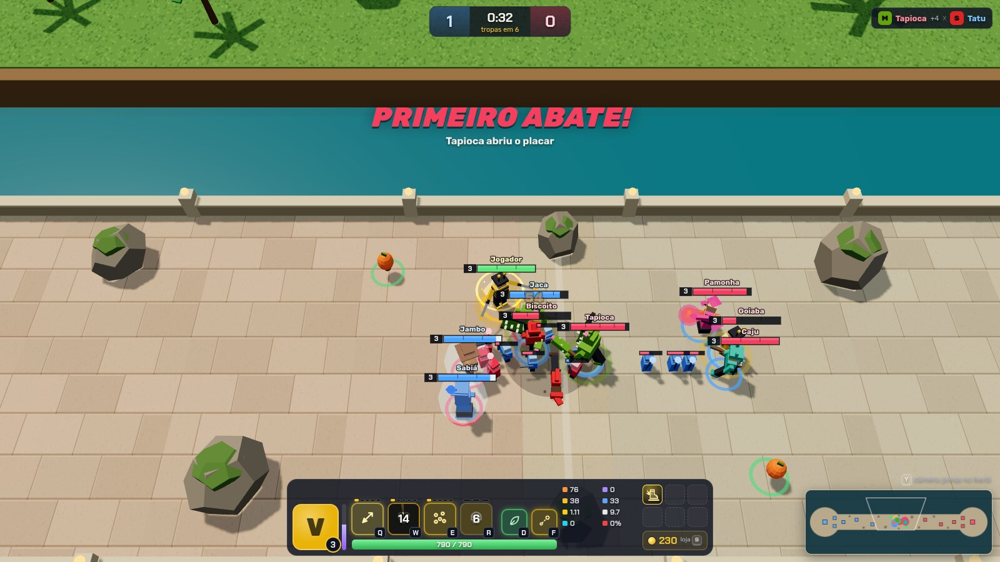
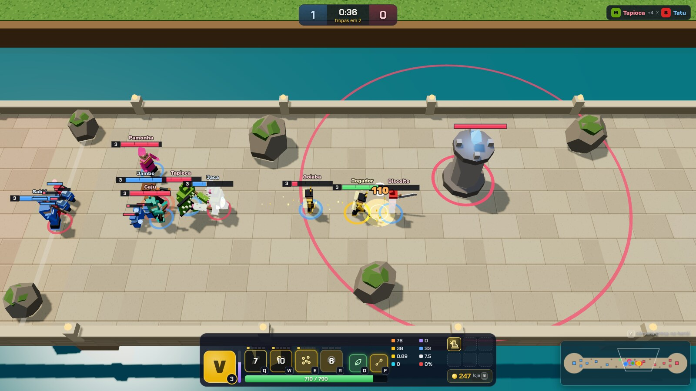
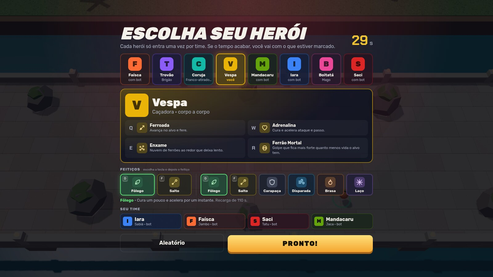
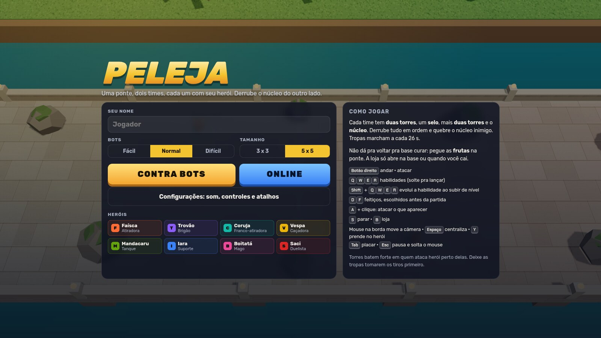

<h1 align="center">PELEJA</h1>

<p align="center">
  <b>Uma ponte, dois times, cada um com seu herói. Derrube o núcleo do outro lado.</b><br />
  MOBA de uma rota só, em 3D, direto no navegador. Contra bots ou online com os amigos.
</p>

<p align="center">
  
</p>

## O jogo

Dois times de até cinco heróis se enfrentam numa ponte só. Cada lado tem **duas torres**, um **selo**, mais **duas torres** e o **núcleo**: derrube tudo em ordem e quebre o núcleo inimigo.

- **Tropas** marcham dos dois lados a cada 26 segundos.
- **Cura**: frutas espalhadas pela ponte, ou voltando pra base com `B` (8 segundos parado; dano ou qualquer ação cancela). Na fonte a vida volta depressa.
- **A loja só abre na base ou quando você cai**, então voltar pra comprar custa tempo de rota.
- **Canhão da base**: clique com o botão direito no canhão ao lado da fonte pra entrar nele. A câmera abre e você tem 5 segundos pra clicar onde quer cair, em volta da torre mais avançada do seu time que ainda está de pé (sem clicar, cai atrás dela; `S` desiste). No ar ninguém te acerta, e a queda joga pro alto os inimigos que estiverem embaixo. Sem as duas torres da ponte, o canhão para de atirar.
- **Golpe começado sai**: depois que o herói ergue a arma, o ataque básico acerta mesmo que o alvo dê uns passos pra trás. Só escapa quem avança ou salta pra longe. E bater não deixa ninguém pra trás: atrás de quem foge, o herói vai andando enquanto golpeia.
- **Moitas**: seis touceiras de capim nas bordas da ponte, três de cada lado. Herói dentro some pro time inimigo e o próprio time vê ele meio transparente. Quem entra na mesma moita (herói ou tropa) enxerga quem está lá. Atacar ou usar habilidade revela por 1 segundo. Ninguém clica em quem não vê, mas disparo e área acertam normal.
- **Torres batem forte** em quem ataca herói perto delas. Deixe as tropas tomarem os tiros primeiro.
- **Em estruturas só o ataque básico fere**, e ele soma o ataque inteiro, 60% do poder e 1,5% da vida máxima: mago, suporte e tanque também derrubam torre.
- **Habilidades em área também desgastam torres**, com 30% do dano. Disparos num alvo só passam direto por elas.

<p align="center">
  
</p>

## Heróis

Quinze heróis do folclore e do sertão, cada um com quatro habilidades (Q, W, E e a suprema no R) que evoluem conforme você sobe de nível.

| Herói | Papel | Alcance |
| --- | --- | --- |
| **Faísca** | Atiradora | À distância |
| **Trovão** | Brigão | Corpo a corpo |
| **Coruja** | Franco-atiradora | À distância |
| **Vespa** | Caçadora | Corpo a corpo |
| **Mandacaru** | Tanque | Corpo a corpo |
| **Iara** | Suporte | À distância |
| **Boitatá** | Mago | À distância |
| **Saci** | Duelista | Corpo a corpo |
| **Cuca** | Lutadora | Corpo a corpo |
| **Curupira** | Mago | À distância |
| **Boto** | Mago | À distância |
| **Caipora** | Maga | À distância |
| **Fulozinha** | Suporte | À distância |
| **Uirapuru** | Suporte | À distância |
| **Zé Pilintra** | Suporte | À distância |

O herói é **sorteado** no começo de cada partida: ninguém escolhe, mas dá pra sortear de novo duas vezes.

Antes da partida você escolhe dois **feitiços** pras teclas D e F:

| Feitiço | O que faz |
| --- | --- |
| **Fôlego** | Cura um pouco e acelera por um instante. |
| **Salto** | Some num clarão e reaparece onde o mouse aponta. |
| **Carapaça** | Um escudo forte por 2,5 segundos. |
| **Disparada** | Corre bem mais rápido por 6 segundos. |
| **Brasa** | Queima um herói inimigo com dano que ignora defesas. |
| **Laço** | Laça um herói inimigo e deixa ele bem lento. |

<p align="center">
  
</p>

## Loja

São **71 itens** do folclore e do sertão, em três camadas (básicos, intermediários e grandes), montados a partir das peças. Itens só dão atributos: ataque, poder, aceleração de habilidade, velocidade de ataque, crítico, roubo de vida, armadura, resistência mágica e vida (e passo nas botas).

**Roubo de vida**: o ataque básico em herói ou tropa cura uma parte do dano que entrou (com 15%, um golpe de 200 cura 30). Não vale em torre nem em habilidade. As exceções são os itens **de usar**, nas teclas `1` a `6`: a **Carranca**, que vira estátua por 2,5 s, e três de suporte que valem pra você e pros aliados em volta (a **Água de Cheiro** cura, a **Figa de Guiné** dá escudo e o **Berrante do Vaqueiro** acelera).

| Linha | Itens grandes |
| --- | --- |
| Ataque | Garra do Lobisomem, Presa da Cobra-Grande, Borduna de Anhangá, Gume do Cangaceiro, Lança das Icamiabas, Garra da Onça-Pintada, Tacape do Bradador, Fita do Bonfim |
| Atirador | Arco da Caipora, Agouro da Acauã, Rasga-Mortalha, Assobio da Matinta, Chocalho da Cascavel, Tambor de Maracatu, Olho do Pai-do-Mato, Peixeira de Lampião |
| Roubo de vida | Presa do Chupa-cabra, Foice do Corpo-Seco, Lança do Labatut |
| Poder | Cajado de Tupã, Cocar do Pajé, Coração da Mãe-do-Ouro, Véu da Mãe-d'Água, Carranca, Cuia da Benzedeira, Fogo da Mula sem Cabeça, Rosário da Rezadeira, Cabaça do Pajé |
| Suporte (de usar) | Água de Cheiro, Figa de Guiné, Berrante do Vaqueiro |
| Defesa | Casco de Jabuti, Manto de Jaci, Couro do Mapinguari, Armadura de Xique-xique, Raiz de Sumaúma, Tambor do Boi-Bumbá, Couraça do Tatu-Canastra, Escama do Pirarucu, Rede de Tucum, Tronco do Jequitibá, Bandeira do Divino, Cuia de Tacacá |

Cada herói tem **afinidade** com certos atributos (rendem 20% a mais nele). Em **Recomendados**, a loja mostra por onde começar e **três builds do herói**, montadas pelo que as habilidades dele usam (por exemplo, dano, sobrevivência ou ajudar o time). Clique no nome de uma pra loja seguir ela; a escolha fica lembrada. Os bots também usam essas builds.

<p align="center">
  
</p>

## Controles

Todos os atalhos podem ser trocados em **Configurações**.

| Tecla | Ação |
| --- | --- |
| Botão direito | Andar e atacar |
| `Shift` + botão direito | Ataca só heróis (sem herói no mouse, só anda) |
| Botão direito no canhão da base | Entra no canhão; depois, clique onde quer cair |
| `Q` `W` `E` `R` | Habilidades (por padrão, mira segurando e lança ao soltar) |
| `Shift` + habilidade | Evolui a habilidade ao subir de nível |
| `C` + habilidade | Só mostra o alcance: o clique esquerdo lança e o direito cancela, seja qual for o modo de lançamento |
| `D` `F` | Feitiços |
| `1` a `6` | Usa os itens do inventário |
| `A` + clique | Avança atacando o que aparecer (com `Shift`, só heróis) |
| `S` | Parar |
| `B` | Voltar pra base |
| `P` | Loja |
| `Espaço` | Centraliza a câmera no herói |
| `Y` | Prende ou solta a câmera |
| `Tab` | Placar |
| `Esc` | Pausa e solta o mouse |

<p align="center">
  
</p>

## Rodando

Precisa de [Node.js](https://nodejs.org) 18 ou mais novo.

```bash
git clone https://github.com/ricardoraposo/peleja.git
cd peleja
npm install
```

### Contra bots

```bash
npm run dev
```

Abra o endereço que o Vite mostrar. No servidor de desenvolvimento também aparece o **Treino livre**, um modo sem partida pra testar heróis, itens e mecânicas (cria bonecos, bots e tropas, zera recargas, muda a velocidade do jogo).

### Online

```bash
npm run online
```

Faz o build e sobe o servidor em `http://localhost:7788`. Crie uma sala, mande o link ou o código de 4 letras pros amigos, escolham os times, completem com bots se quiser e comecem.

Pra jogar com gente de fora da sua rede, exponha a porta com `npm run tunnel` (usa o [ngrok](https://ngrok.com)).

| Variável | Padrão | Pra quê |
| --- | --- | --- |
| `PORT` | `7788` | Porta do servidor |
| `TEAM` | `5` | Tamanho padrão dos times |
| `DIFFICULTY` | `normal` | Dificuldade padrão dos bots (`facil`, `normal`, `dificil`) |

## Por dentro

- **[Three.js](https://threejs.org)** pra renderização, **[Vite](https://vite.dev)** pro build e **[ws](https://github.com/websockets/ws)** pro servidor. Nada além disso.
- **Uma simulação só** (`src/sim.js`): a mesma roda no navegador nas partidas contra bots e no servidor nas partidas online, que é autoritativo.
- **Rede enxuta** (`src/wire.js`): 30 ticks por segundo de simulação, 20 snapshots por segundo em formato binário com delta.
- **Tudo feito em código**: modelos, efeitos, ícones e sons são gerados em tempo de execução, sem arquivos de arte ou áudio.

```text
src/
  sim.js       regras do jogo e simulação
  bot.js       inteligência dos bots
  config.js    heróis, itens, feitiços e números de balanceamento
  game.js      cliente: câmera, entrada e interpolação
  models.js    modelos 3D dos heróis, tropas e estruturas
  effects.js   efeitos visuais das habilidades
  hud.js       interface da partida e loja
  net.js       transporte local e por WebSocket
  wire.js      protocolo binário
server/
  index.js     salas, saguão e servidor das partidas online
scripts/       testes de simulação, estresse e protocolo
```

Scripts de teste: `npm run sim`, `npm run stress` e `npm run wire`. Pra medir o balanceamento, `npm run balance -- 200 5` roda 200 partidas 5x5 de bots em paralelo e mostra vitória, dano, mortes, dano em torre e uso das habilidades de cada herói (troque o 5 por 3 pro 3x3).
